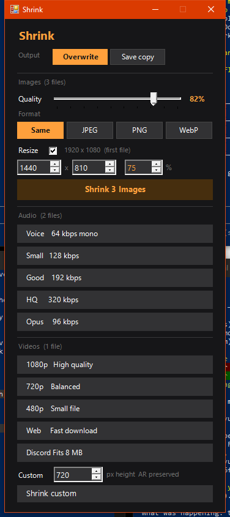
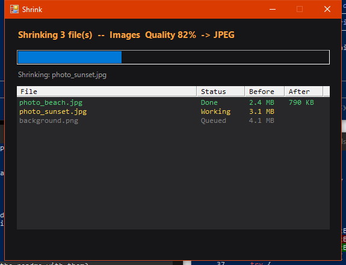
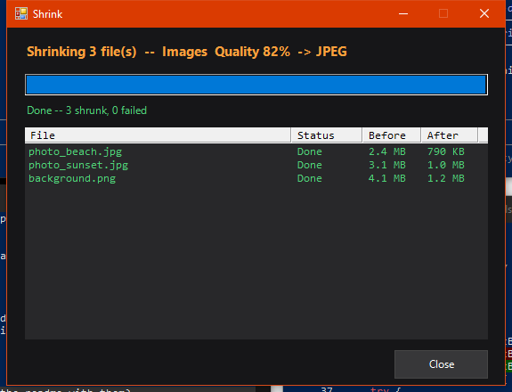

# Shrink Menu

Right-click any image, audio, or video on Windows → **Shrink...** → instant size picker GUI.

> **Platform:** Windows only. The compression engine is PowerShell-native and relies on Windows shell integration. A Python-based cross-platform port (macOS + Linux) is planned.

## Screenshots

| Picker | In progress | Done |
|--------|-------------|------|
|  |  |  |

## Install

**One click:** Download **[ShrinkMenu-Install.exe](../../releases/latest/download/ShrinkMenu-Install.exe)** and run it. No admin required. The installer (Inno Setup, per-user) is code-signed by Yuval Olsha, runs no scripts, and adds a normal uninstall entry in Settings > Apps. Up to v1.4.1 it was an IExpress package running `powershell -ExecutionPolicy Bypass` plus a VBScript launcher, a chain antivirus flags.

**Manual:** Clone the repo, right-click `install.ps1` → Run with PowerShell.

## What it does

### Images (requires ImageMagick)
- Quality slider 10–100%
- Format: keep same / JPEG / PNG / WebP
- **Smart resize**: probes actual image dimensions — linked W × H + % fields, change any one and the others update automatically with AR preserved
- Lossless auto-convert: if you pick PNG/BMP/TIFF with "Same" format, prompts to switch to JPEG or WebP for guaranteed compression
- **Overwrite** original or **Save copy** with `_shrunk` suffix
- "No change" status if output is not smaller than input

### Audio (requires ffmpeg)
| Preset | Bitrate | Notes |
|--------|---------|-------|
| Voice | 64 kbps mono MP3 | voice memos, podcasts — tiny |
| Small | 128 kbps MP3 | general use, ~70% smaller than WAV/FLAC |
| Good | 192 kbps MP3 | music quality |
| HQ | 320 kbps MP3 | max MP3, best for lossless source |
| Opus | 96 kbps .opus | modern codec, smallest size |
| WAV 24-bit | PCM lossless .wav | downconvert from 32-bit float — delivery format |
| WAV 16-bit | PCM lossless .wav | downconvert for max compatibility (CD) |

### Videos (requires ffmpeg)
| Preset | Resolution | Notes |
|--------|-----------|-------|
| 1080p | 1920×? | ~50% smaller, high quality, AR preserved |
| 720p | 1280×? | ~70% smaller, balanced, AR preserved |
| 480p | 854×? | ~85% smaller, small file, AR preserved |
| Web | 1280×? | fast-start, streaming optimized |
| Discord | 854×? | targets Discord 8 MB free upload limit |
| Custom | any height | enter exact px height, width auto-calculated |

Before/after file size shown per file in the progress window.

### Any file name

Names with smart quotes (`’`), accents, `[brackets]` or `%` are handled correctly. Earlier versions silently skipped them — the Explorer file list was handed over in the system codepage and read back as UTF-8, so those names stopped resolving. Fixed in v1.4.1.

## Requirements

- ImageMagick 7+ — [imagemagick.org](https://imagemagick.org/script/download.php#windows)
- ffmpeg — [gyan.dev/ffmpeg/builds](https://www.gyan.dev/ffmpeg/builds/)

The installer handles both. A copy already on your PATH is used as-is. If one is missing, the installer downloads it (about 35 MB for ffmpeg, 12 MB for ImageMagick), checks its SHA-256, puts it in `%LOCALAPPDATA%\Programs\DVLCE\<tool>` and adds that folder to your user PATH. It takes the newest release from GitHub: ffmpeg from [GyanD/codexffmpeg](https://github.com/GyanD/codexffmpeg) (gyan.dev's own mirror), ImageMagick from [ImageMagick/ImageMagick](https://github.com/ImageMagick/ImageMagick/releases). FFmpeg Convert and Doc Convert use the same shared folder, so each tool is downloaded once. Uninstalling removes a shared copy only when no other of these tools still needs it.

## Integration

The installer registers **Shrink...** on right-click for:

**Images:** jpg jpeg png webp bmp tiff gif heic heif avif
**Audio:** mp3 wav flac aac ogg wma m4a opus aiff ape
**Videos:** mp4 mkv avi mov webm wmv flv ts m4v 3gp

A **Shrink...** button also appears at the bottom of the [FFmpeg Convert](https://github.com/toyuvalo/ffmpeg-context-menu) and [Doc Convert](https://github.com/toyuvalo/doc-convert-menu) pickers.

## Uninstall

Settings > Apps > Shrink Menu > Uninstall. For a manual install, run `uninstall.ps1` with PowerShell.

## Build the exe yourself

```cmd
build.cmd
```

Requires Inno Setup 6 (`winget install JRSoftware.InnoSetup`). The launcher is compiled with the in-box C# compiler. The build signs everything with Azure Artifact Signing; set `NOSIGN=1` to build unsigned. ImageMagick on PATH regenerates the icon automatically.

### Testing the dependency download

`installer\dvlce-deps.iss` holds the download code (an identical copy is in each tool repo). `test\deps-harness.iss` is a test installer with its own AppId and no menu entries. It ignores the PATH, so it always downloads. Compile it with `ISCC.exe test\deps-harness.iss`, run it, and check `%LOCALAPPDATA%\Programs\DVLCE`. Its uninstall removes the folders, unless `HKCU\Software\Microsoft\Windows\CurrentVersion\Uninstall\{00D3B5A1-7E2C-4F18-9A6B-DE9500000002}_is1` exists (a stand-in for another tool that still needs them).

## More tools like this

Built by [dvlce.ca](https://dvlce.ca) — see [webdev.dvlce.ca](https://webdev.dvlce.ca) for the full project showcase.

## License

MIT with [Commons Clause](https://commonsclause.com/) — free to use, modify, and share. Commercial resale not permitted.
